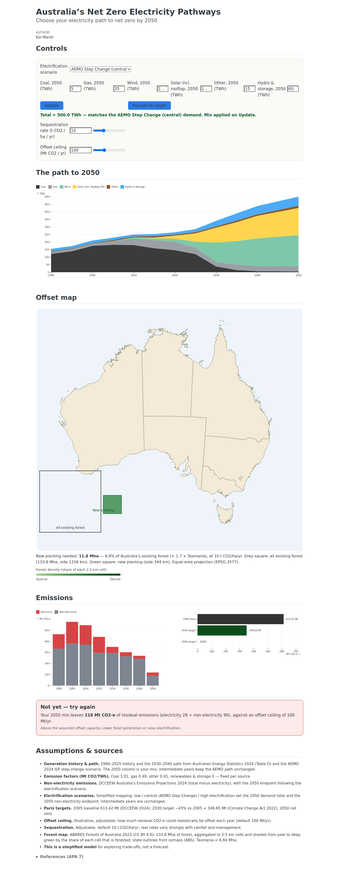

# Interactive dashboard: can Australia's 2050 electricity mix hit net zero?

**Live demo → [emitdb.ksmarsh.net](https://emitdb.ksmarsh.net)** (static Quarto + Observable JS build; loads in ~1–3 s)

**Executive summary**
- Question: what 2050 electricity mix gets Australia to its Paris net-zero target, and how much forest would be needed to offset whatever is left?
- Finding: with AEMO's 2024 step-change mix (5 TWh coal, 35 TWh gas), electricity emissions are small, but total 2050 emissions (≈118 Mt CO₂-e) still exceed an illustrative 100 Mt/yr offset capacity. Non-electricity sectors are the binding constraint.
- So what: it turns a technical projection into a scenario tool a non-specialist can explore in a minute.

**Approach**: Historical generation (Australian Energy Statistics 2024) and the AEMO 2024 ISP path to 2050 are combined with per-source emission factors and DCCEEW non-electricity projections. Users choose a 2050 mix that must sum to the scenario's demand (or rescale it in one click), pick an electrification scenario, and set the offset ceiling and sequestration rate. The page recomputes the emissions path, compares it with Paris commitments (2005 baseline, −43% 2030 target, 2050 net zero), and maps the plantation area needed to offset the residual against Australia's actual forest cover.

**Key features**
- Electrification scenario (low / AEMO Step Change / high) sets the 2050 demand total and non-electricity endpoint
- Six 2050 mix inputs with a live running total; **Update** only applies when the total matches, or **Rescale to target** normalises in one click
- Stacked generation-mix area chart, 1990–2050 (AEMO path kept for intermediate years)
- Emissions stack vs Paris target bars, with a pass/fail verdict against an adjustable offset ceiling
- Offset map: ABARES *Forests of Australia 2023* cover overlaid on the states, with to-scale squares for all existing forest and the new planting needed

**Limitations**
- A simplified model for exploring trade-offs, not a forecast; emission factors are fixed per source
- Electrification scenarios are simplified mappings to 2050 endpoints; intermediate years keep the AEMO path
- Sequestration assumes a uniform, adjustable rate (default 10 t CO₂/ha/yr); real rates vary strongly with rainfall

**Companion piece**: [*The Myth of Energy Transitions*](companion-video-essay/script.md), a short data-storytelling video essay (script and slides).

**Tools**: R · Shiny · ggplot2 · dplyr/tidyr · sf · ozmaps · terra · Quarto · Observable JS (Observable Plot)

**Reproduce**: The web build lives in `web/` (Quarto + Observable JS; the data layer is `web/prep_data.R`, outputs in `web/data/`). Rebuild with `web/render.sh`. The original R Shiny app is preserved in `app/` (R 4.5, packages pinned in `app/renv.lock`; `renv::restore(project = "app")` then `shiny::runApp("app")`).

**Deployment**: `site/` is the committed static build; `.github/workflows/deploy-dashboard.yml` uploads it to Aliyun OSS (Hong Kong) on every push to `main` that touches `site/**`, served over HTTPS via Cloudflare.
