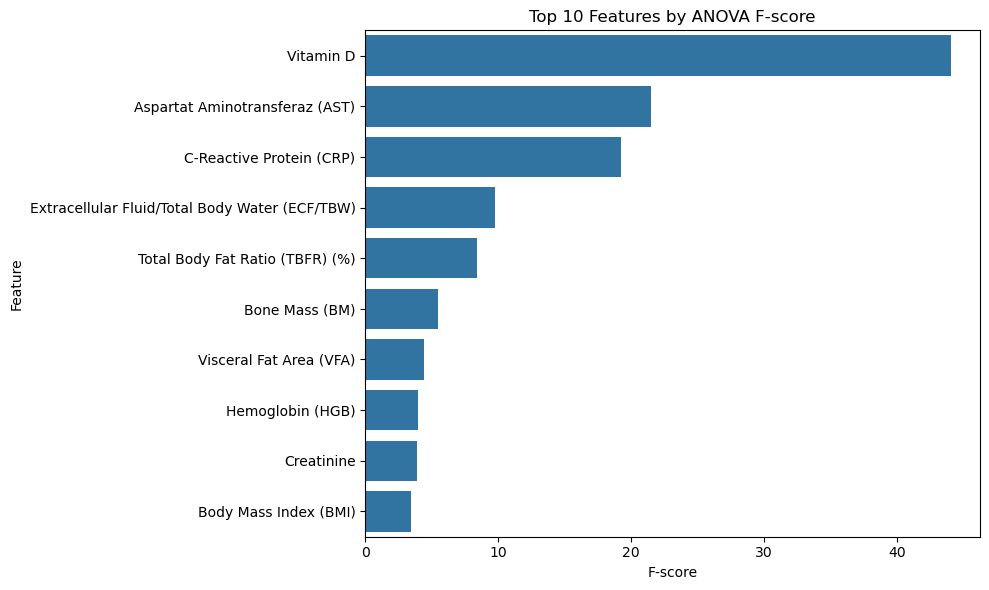

# Routine blood tests predict gallstone disease with 81% accuracy, no imaging needed

**Executive summary**
- Question: can non-imaging clinical measurements flag patients likely to have gallstones before ultrasound?
- Finding: logistic regression on 10 selected features reaches 81% test accuracy and an AUC of 0.856. Vitamin D and CRP are the strongest predictors.
- So what: a cheap triage score built from tests that are already collected could prioritise who gets imaged first.

**Approach**: 319 patients with 38 demographic, bioimpedance and laboratory features (UCI). Highly correlated features were removed, multicollinearity checked with VIF, and outliers trimmed; ANOVA F-tests then selected the 10 most separating features. Logistic regression, random forest and XGBoost were tuned with `GridSearchCV` and compared on a stratified hold-out set, with 5-fold cross-validation and paired t-tests. These three cover a range from interpretable-linear to flexible-nonlinear.

**Key findings**
- All three models reach about 81% test accuracy
- Logistic regression has the highest AUC (0.856) and precision for positive cases (0.87); the tree models have higher recall (0.78 vs 0.70)
- Most differences between models aren't statistically significant, so the simpler, interpretable model is preferred
- Lower vitamin D and higher CRP are associated with gallstone presence

**Limitations**
- A single hospital and 319 patients; external validation is needed
- Only about 40 patients had comorbidities, which limits analysis of their role
- Correlation filtering and outlier removal were applied before the train/test split, which could slightly inflate the hold-out estimate

**Full report**: [PDF](report.pdf) · [HTML](report.html) · [notebook](analysis.ipynb)
**Tools**: Python · pandas · scikit-learn · XGBoost · statsmodels · seaborn
**Reproduce**: `pip install pandas scikit-learn xgboost statsmodels seaborn openpyxl`, then run `analysis.ipynb` (data in `data/`, see [data note](data/README.md))
