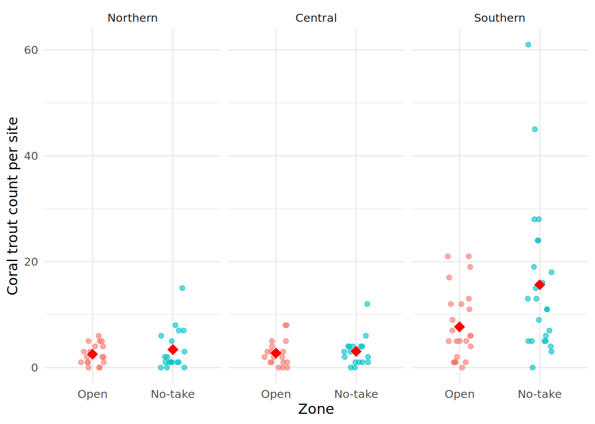

# No-take zones hold ~76% more coral trout, and correcting for overdispersion changed the advice

**Executive summary**
- Question: how does coral trout abundance on the Great Barrier Reef vary with latitude and fishing zone, and can lost reef management classes be recovered from survey counts alone?
- Finding: no-take sites hold 1.76× the coral trout of open sites (95% CI 1.25–2.49). An apparent "zoning works differently by region" effect disappeared once overdispersion was modelled properly.
- So what: the client got one robust zoning estimate instead of a misleading region-specific recommendation, plus a method to rebuild lost classification records with stated confidence.

**Approach**: *Part I* uses 120 AIMS monitoring sites (2012). A Poisson GLM with log link was checked for dispersion (φ̂ ≈ 5.4), refitted as quasi-Poisson, and compared with F-tests; diagnostics covered residuals, leverage, Cook's distance and a refit without the most influential site. *Part II* (simulated data) fits a three-class Poisson mixture with a hand-derived, hand-coded EM algorithm, then a semi-supervised extension that uses a batch of labelled records.

**Key findings**
- No-take vs open: rate ratio 1.76 (95% CI 1.25–2.49); Southern vs Northern: about 3.96× (95% CI 2.43–6.45)
- The zone × latitude interaction looked significant under Poisson (p ≈ 0.009) but not after the overdispersion correction (p ≈ 0.42)
- The conclusions hold without the most influential site
- Part II recovers class shares of about 29% / 29% / 42% with typical counts of about 6, 20 and 38; 87% of reefs are classified with more than 90% confidence

**Limitations**
- The data are observational and from a single year, so the zoning association isn't causal
- A negative-binomial model is a natural sensitivity check
- Part II uses simulated data

**Full report**: [PDF](report.pdf) · [Read online](https://kyanite03.github.io/analytics-case-studies/03-coral-trout-reef-monitoring/report.html)
**Tools**: R · ggplot2 · Quarto
**Reproduce**: `quarto render analysis.qmd` (Part I data included; Part II data see [data note](data/README.md))
