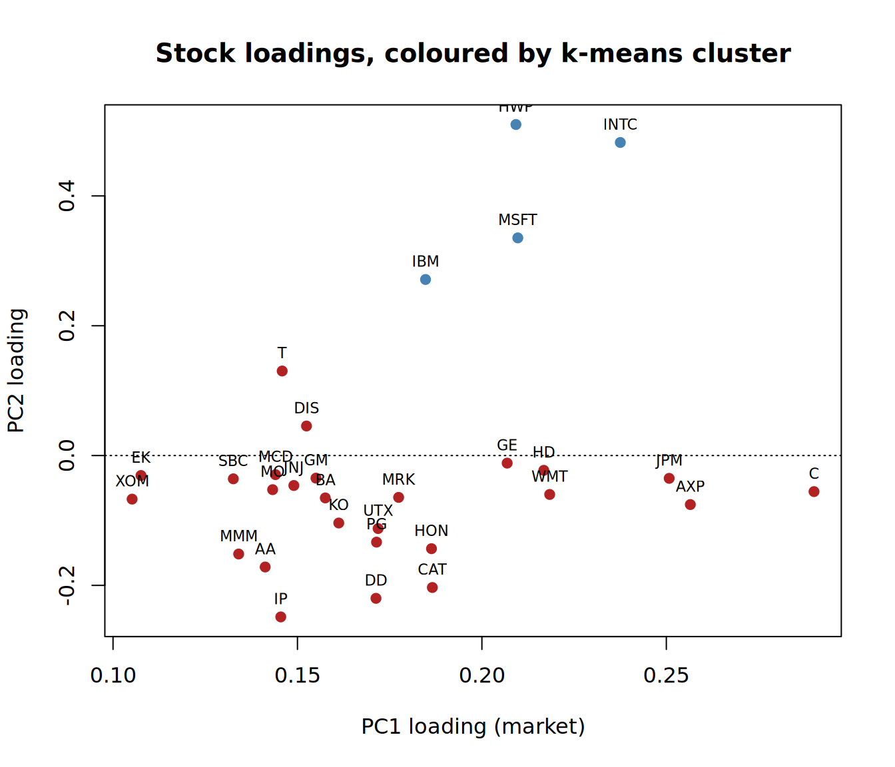

# One market factor drives Dow Jones returns, and tech stocks cluster apart

**Executive summary**
- Question: how much of the co-movement in Dow Jones stocks is a single market factor, and which stocks move together?
- Finding: the first principal component explains 28.2% of return variance (next: 7.9%). k-means isolates HWP, INTC, IBM and MSFT as a technology cluster.
- So what: holding several of the tech names diversifies less than the ticker count suggests; their average correlation with each other is 0.44, against 0.20 with the rest.

**Approach**: 1,200 days of daily returns for the 30 DJIA constituents. Eigen-decomposition of the covariance matrix measures the factor structure; k-means (25 random starts) clusters stocks, then trading days for k = 2–9 using within/between sums of squares. These are simple, transparent unsupervised methods that suit a first look at the structure.

**Key findings**
- The covariance matrix has full rank, with one dominant eigenvalue (the market factor)
- Technology stocks separate on PC2 and form their own k-means cluster
- Trading days split into market-up and market-down groups (+0.89% vs −0.75% mean return); there are no discrete regimes and no clear elbow

**Limitations**
- k-means on raw returns gives volatile stocks and days more weight
- The results come from a single historical window, so cluster stability isn't tested

**Full report**: [PDF](report.pdf) · [Read online](https://kyanite03.github.io/analytics-case-studies/04-equity-return-clustering/report.html)
**Tools**: R (base) · Quarto
**Reproduce**: `quarto render analysis.qmd` (data not redistributed, see [data note](data/README.md))
