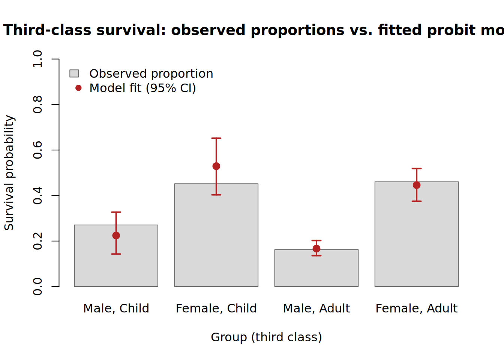

# Likelihood from first principles: survival, odds and GLM theory in three client briefs

**Executive summary**
- Question: three short briefs, each with a plain-language answer and full technical working: Titanic survival by sex and age, penguin sex vs body mass, and a gamma-GLM methodology note.
- Finding: an adult female in third class had an estimated 44.6% chance of survival (95% CI 37.5%–51.9%); each extra 500 g of body mass multiplies the odds of a male penguin record by 1.86 (95% CI 1.57–2.20).
- So what: this shows the full chain from likelihood to an answer a manager can use, without relying on `glm()`.

**Approach**: the probit binomial model is built by hand (log-likelihood, `optim()` with convergence checks, analytic Fisher information, Wald intervals, a likelihood-ratio test, and a probability interval formed on the linear-predictor scale). The penguin brief uses a logistic GLM and odds-ratio interpretation. The gamma note derives the exponential-family form, canonical link and variance function.

**Key findings**
- Sex was strongly associated with survival after accounting for age group (likelihood-ratio statistic 55.9 on 1 df, p ≈ 7.6 × 10⁻¹⁴)
- The age-group effect's interval includes zero once sex is accounted for
- The penguin mass–sex association is strong but likely confounded by species

**Limitations**
- Grouped historical records describe associations, not individual causes
- The single-predictor penguin model omits species

**Full report**: [PDF](report.pdf) · [HTML](report.html)
**Tools**: R · Quarto · palmerpenguins
**Reproduce**: `quarto render analysis.qmd`
