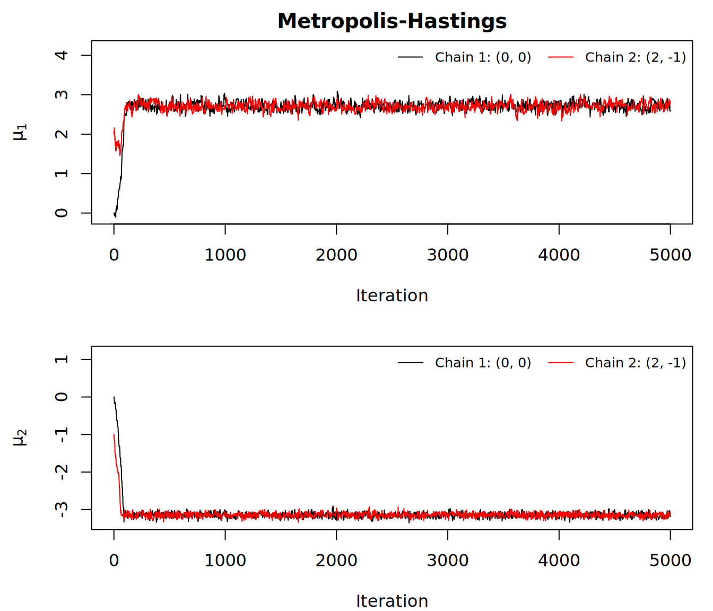

# Exact, MCMC and variational inference agree, at very different costs

**Executive summary**
- Question: how do exact conjugate analysis, Gibbs sampling, Metropolis–Hastings and mean-field variational inference compare on the same posterior?
- Finding: all methods recover the same posterior means (Gibbs μ₁ = 2.713, μ₂ = −3.144; MH 2.721, −3.148). Gibbs converges almost immediately, MH needs a burn-in, and VI slightly understates variance.
- So what: this shows how to choose and validate an inference method, including when a cheap approximation is safe.

**Approach**: everything is written from scratch in base R. It covers the conjugate Gamma posterior and Student-t predictive, Gibbs full conditionals, a random-walk MH sampler (acceptance about 0.44), effective sample size and Gelman–Rubin R̂, and the CAVI updates with the ELBO. Each method is checked against the exact bivariate-normal posterior.

**Key findings**
- The precision posterior is Gamma(52, 2427.4), implying a score SD of about 6.8; the derived t predictive matches simulation
- Gibbs and MH posterior means differ by only a few Monte Carlo standard errors
- CAVI converges to the same optimum from every start; mean-field variances (1/103, 1/303) sit just below the exact marginals because the posterior correlation is near zero (−0.011)

**Limitations**
- The data are simulated and the model is low-dimensional and conjugate, which is ideal for validation but easier than real problems

**Full report**: [PDF](report.pdf) · [HTML](report.html)
**Tools**: R (base) · Quarto
**Reproduce**: `quarto render analysis.qmd` (data not redistributed, see [data note](data/README.md))
